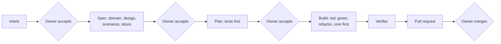

# dev-plugins

Claude Code plugins for disciplined, issue-driven software development, maintained by [oriw-app](https://github.com/oriw-app). This repository is a Claude Code **plugin marketplace**: one place to install every plugin from.

| Plugin | What it does |
| --- | --- |
| [**issuewright**](plugins/issuewright) | An issue-driven, AI-native development workflow. GitHub issues are the spec; the owner accepts intent, spec and plan; Claude builds with DDD + BDD + TDD in a hexagonal architecture with command–query separation; hooks enforce every rule. |

## issuewright in one picture



Everything is recorded on the GitHub issue. The full guide, with every flowchart, template and rule, is [WORKFLOW.md](plugins/issuewright/skills/issuewright/WORKFLOW.md).

## Requirements

- [Claude Code](https://claude.com/claude-code)
- `git`, the GitHub CLI `gh` (signed in with `gh auth login`) and `jq`

## Install

**For a whole team (recommended).** Commit this to the project's `.claude/settings.json`; everyone who opens the project in Claude Code is asked to install it:

```json
{
  "extraKnownMarketplaces": {
    "dev-plugins": { "source": { "source": "github", "repo": "oriw-app/dev-plugins" } }
  },
  "enabledPlugins": { "issuewright@dev-plugins": true }
}
```

**For yourself.** Inside Claude Code:

```
/plugin marketplace add oriw-app/dev-plugins
/plugin install issuewright@dev-plugins
```

Or from a terminal:

```sh
claude plugin marketplace add oriw-app/dev-plugins
claude plugin install issuewright@dev-plugins
```

Restart Claude Code after installing.

## Switch it on in a project

The hooks only act in projects that contain `.claude/issuewright.json`, so installing the plugin never affects other work. Add the file (every field is optional):

```json
{
  "mainBranch": "main",
  "sourceGlobs": ["src/**"],
  "testGlobs": ["tests/**", "features/**"],
  "docsGlobs": ["docs/**", "*.md", "features/**"],
  "featuresDir": "features",
  "domainDoc": "docs/DOMAIN.md",
  "architectureDoc": "docs/ARCHITECTURE.md",
  "quickCheck": "scripts/check --quick",
  "quickCheckTimeout": 300,
  "fullCheck": "scripts/check"
}
```

| Field | Used for |
| --- | --- |
| `mainBranch` | The protected branch; no edits or commits on it |
| `sourceGlobs` | Code that needs a test changed first (`test-first`) |
| `testGlobs` | Tests and scenarios; locked once committed on `fix/` branches |
| `docsGlobs` | Files allowed before the plan is accepted |
| `featuresDir` | Where Gherkin feature files live |
| `domainDoc`, `architectureDoc` | Glossary and architecture notes the skills read and update |
| `quickCheck`, `quickCheckTimeout` | Run before Claude may finish a turn on an issue branch |
| `fullCheck` | Run by the verifier |

Then create the labels used by the gates (once per repository):

```sh
for l in "intent: accepted" "spec: accepted" "plan: accepted" "test: change approved" "blocked" "needs changes" "spike" "sprint"; do
  gh label create "$l" --force
done
```

## Use

| Command | When |
| --- | --- |
| `/intent` | A new idea, request or finding: writes the Intent on an issue |
| `/spec` | After the owner adds `intent: accepted`: domain, design, scenarios, sub-issues |
| `/milestone-plan` | Start of a release: goal, scope, date, refinement list |
| `/sprint-plan` | Start of a sprint: picks Ready work, sets the sprint goal |
| `/next` | Start of a session: picks the next issue and loads it |
| `/plan` | Starting an issue: files, tests-first order, risks, proof; creates the branch and draft pull request |
| `/ship` | Work complete: verifier, Definition of Done, pull request ready, self-review |
| `/handoff` | Stopping mid-way: leaves notes on the issue for the next session |
| `/bug` | Something broken: failing scenario first, then the fix |
| `/sprint-review` | End of a sprint: report and retro |
| `/release` | End of a milestone: prepares the release for the owner |

Plugin commands can also be typed with the plugin prefix, for example `/issuewright:spec`.

The owner's part is three labels (`intent: accepted`, `spec: accepted`, `plan: accepted`), merging pull requests and authorising releases. Claude can't do any of those; the hooks stop it.

### What the hooks enforce

| Hook | Rule |
| --- | --- |
| `load-issue` | Each session starts with the branch's issue loaded as the spec |
| `edit-guard` | No edits on the main branch; only docs and scenarios before `plan: accepted`; a test must change before source code; a committed failing test on a `fix/` branch can't be edited; no secrets in files |
| `guard-git` | No force-push, no push or commit to main, no skipped checks, no merging, no tags or releases, no gate labels |
| `checks-before-done` | Claude keeps working until `quickCheck` passes |

## Update

```
/plugin marketplace update dev-plugins
```

or `claude plugin update issuewright@dev-plugins`, then restart Claude Code.

## Turn off or uninstall

- Turn it off for one project: remove `.claude/issuewright.json` (hooks stop) or set `"issuewright@dev-plugins": false` in `.claude/settings.json`.
- Turn it off for yourself: `claude plugin disable issuewright@dev-plugins`.
- Uninstall: `claude plugin uninstall issuewright@dev-plugins`, and optionally `claude plugin marketplace remove dev-plugins`.

## Repository layout

```
.claude-plugin/marketplace.json        the marketplace: lists every plugin
plugins/issuewright/
  .claude-plugin/plugin.json           plugin manifest
  skills/issuewright/WORKFLOW.md       the complete guide with flowcharts
  skills/<command>/SKILL.md            one skill per command and practice
  agents/verifier.md                   checks the work, never edits
  hooks/hooks.json, hooks/*.sh         enforcement
tests/                                 hook tests
```

## Contributing

See [CONTRIBUTING.md](CONTRIBUTING.md). This repository follows its own workflow.

## Licence

[Apache-2.0](LICENSE).
