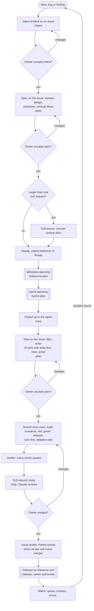
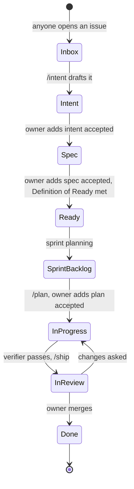
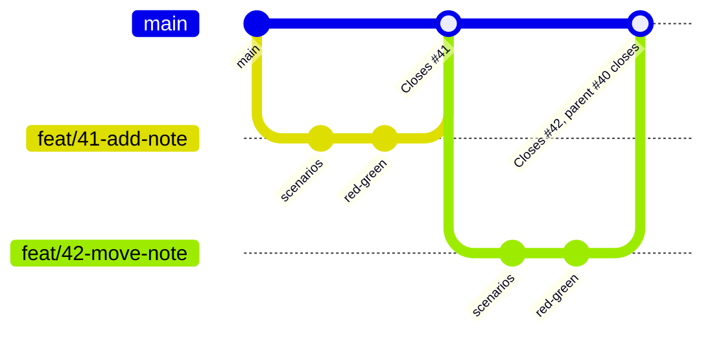
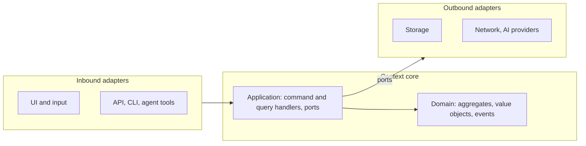
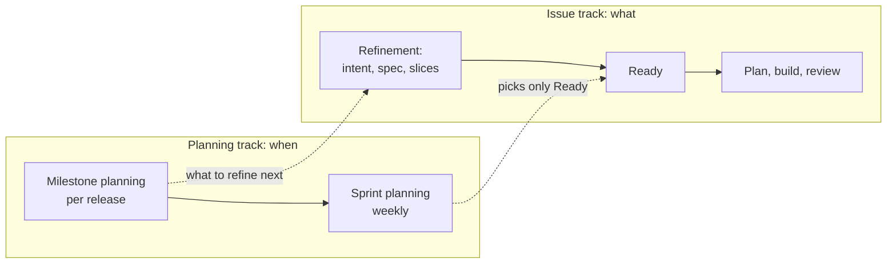
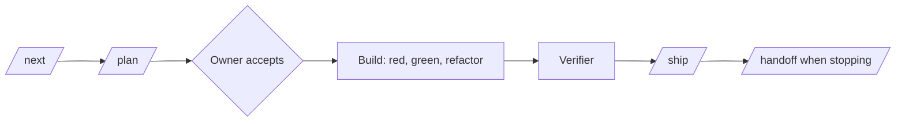

# The AI-native SDLC workflow

How people and Claude build software together, from an idea to a release. GitHub issues are the spec; the code follows domain-driven design (DDD), behaviour-driven development (BDD) and test-driven development (TDD), shaped by a hexagonal architecture with command–query separation (CQS).

This file is the complete reference. It is shipped inside the `ai-sdlc` Claude Code plugin, so every Claude session in every project that uses the plugin follows exactly this text.

## Contents

1. [The whole flow at a glance](#1-the-whole-flow-at-a-glance)
2. [Principles](#2-principles)
3. [Who does what](#3-who-does-what)
4. [Kinds of work](#4-kinds-of-work)
5. [The life of an issue](#5-the-life-of-an-issue)
6. [What goes on an issue](#6-what-goes-on-an-issue)
7. [Definition of Ready and Definition of Done](#7-definition-of-ready-and-definition-of-done)
8. [Branches and pull requests](#8-branches-and-pull-requests)
9. [Building: DDD, BDD, TDD, hexagonal, CQS](#9-building-ddd-bdd-tdd-hexagonal-cqs)
10. [Planning: milestones, sprints and refinement](#10-planning-milestones-sprints-and-refinement)
11. [Other kinds of work](#11-other-kinds-of-work)
12. [Releasing and maintaining](#12-releasing-and-maintaining)
13. [The tooling](#13-the-tooling)
14. [Setting up a project](#14-setting-up-a-project)
15. [Changing this workflow](#15-changing-this-workflow)

## 1. The whole flow at a glance



Gates (diamonds) belong to the owner. Everything between gates is done by Claude, checked by hooks and CI. Every step is recorded on the GitHub issue.

## 2. Principles

1. **GitHub issues are the spec.** Intent, spec, plan, status and handoffs live on the issue. Claude reads the issue and its latest comments before any work and writes back to it. Local notes and memory are never the source.
2. **The repository holds the rules, not the work.** This guide, the project's `CLAUDE.md`, the domain glossary, the architecture notes and the executable scenarios live in git.
3. **People decide, Claude does the work, tools enforce.** The owner accepts intent, spec and plan, merges, and authorises releases. Claude drafts, builds, verifies and reviews. Hooks and CI make the rules impossible to skip.
4. **Small, complete, vertical slices.** Every pull request delivers something that works end to end and merges to `main`. `main` is always releasable and only ever holds finished work.
5. **Words first, behaviour second, code third.** DDD fixes the language, BDD fixes the behaviour, TDD fixes each rule, then the code is written.
6. **Dependencies point inwards.** Domain and application code never touch files, network, time or the screen; adapters do, behind ports.
7. **Every function is a command or a query, never both.**

## 3. Who does what

| Role | Does | Never does |
| --- | --- | --- |
| **Owner** (product owner, founder, tech lead) | Accepts intent, spec and plan; plans milestones and sprints; merges; authorises releases | Writes specs by hand (Claude drafts them) |
| **Claude** | Drafts intents and specs, writes plans, builds, runs the verifier, reviews pull requests, writes handoffs and sprint reports | Accepts its own work, adds gate labels, merges, releases, pushes to `main`, force-pushes |
| **Verifier** (Claude helper agent) | Runs every check and reports what fails | Fixes anything |
| **Contributor** (anyone else) | Opens issues with the templates, sends pull requests for accepted issues | Starts building before the plan is accepted |
| **Hooks and CI** | Enforce the gates and rules on every edit and push | |

## 4. Kinds of work

| Kind | What it is | Branch and pull request |
| --- | --- | --- |
| **Parent issue** (epic) | A feature too big for one pull request. Holds the intent, the whole spec and the list of slices | None. Closes automatically when its last sub-issue closes |
| **Sub-issue** | One vertical slice of a parent: works end to end on its own | One branch, one pull request to `main`, closes on merge |
| **Single issue** | A feature, bug or change that fits one pull request | One branch, one pull request to `main`, closes on merge |
| **Bug** | Something broken, written as a failing scenario | Single issue |
| **Spike** | Time-limited research (at most a day) that answers a question | Branch for notes only; result posted on the issue; no production code merged |
| **Chore** | Dependencies, CI, tidying with no behaviour change | Single issue; plan only, no intent or spec |
| **Sprint** | One issue per sprint holding its goal, scope, report and retro | None |

Two levels at most: parent and sub-issues. Anything bigger is a milestone with several parents.

**Labels** (the same in every repository):

| Group | Labels |
| --- | --- |
| Type | `feature`, `bug`, `spike`, `chore`, `docs`, `sprint` |
| Gates | `intent: accepted`, `spec: accepted`, `plan: accepted` (added by the owner only) |
| State | `blocked`, `needs changes` |
| Area | `area: …`, one per bounded context or part of the product |
| Priority | `priority: must-have`, `priority: should-have`, `priority: nice-to-have` |

**Project board fields:** Status, Iteration (sprint), Milestone (release), Size (`S` half a day, `M` a day, `L` must be split), Context, Priority.

## 5. The life of an issue



| Status | Enters when | Moved by | What changes on the issue |
| --- | --- | --- | --- |
| **Inbox** | Issue opened | Anyone | Rough idea, bug or finding |
| **Intent** | `/intent` filled the Intent section | Claude | Problem, outcome, users, constraints, questions |
| **Spec** | Owner added `intent: accepted` | Owner | Claude writes the Spec section with `/spec` |
| **Ready** | Owner added `spec: accepted`; Definition of Ready met | Owner | Sub-issues created if it's a parent; size set |
| **Sprint backlog** | Chosen at sprint planning | Owner | Iteration set |
| **In progress** | Owner added `plan: accepted` | Owner | Branch created; hooks allow code edits; handoff comments |
| **In review** | Every check passes; pull request marked ready | Claude (`/ship`) | Pull request linked; Claude's review posted |
| **Done** | Owner merged | Owner | Issue closed; parent closed if this was its last sub-issue |

`blocked` is a label, not a status: the issue stays where it is with a comment saying what it waits for. Asking for changes at any gate sends the issue back one step, with the owner's comment.

## 6. What goes on an issue

The issue body always shows the current agreed version. Claude edits it in place (GitHub keeps every earlier version); comments are the log.

### Intent (stage: plan)

```markdown
## Intent
**Problem.** What hurts, for whom, today.
**Proposed outcome.** What will be true when this is done.
**Affected users and systems.** Who and what it touches.
**Constraints.** Rules it must respect: privacy, speed, platforms, licences, dates.
**Open questions.** What we don't know yet.
**How we'll know it worked.** Observable signs of success.
```

### Spec (stage: design)

~~~markdown
## Spec
### Requirements
1. Numbered, testable statements.

### Domain (DDD)
- **Bounded context:** which one owns this.
- **Words:** glossary terms used; new terms marked *(new)* and added to the glossary on the branch.
- **Aggregate(s):** what holds the rules and guards consistency.
- **Commands:** what changes state. **Queries:** what reads it. **Domain events:** facts other parts react to.

### Design (hexagonal)
- **Ports:** interfaces the application needs (storage, clock, transport, AI provider…).
- **Adapters:** what implements them, and what calls in (UI, API, CLI, agent tools).
- **Read models:** what the screens read, updated from events.

### Scenarios (BDD)
```gherkin
Scenario: <outcome in a few words>
  Given …
  When …
  Then …
```

### Slices (parent issues only)
Vertical slices, each usable end to end, in build order. One sub-issue each.

### Flagged concerns
Conflicts with privacy, security, accessibility or other rules, and how they were resolved.
~~~

### Plan (stage: build)

```markdown
## Plan
### Files that change
### Order of work
1. Scenarios for this issue (if not already on the branch).
2. Failing unit tests for the first rule → core code to pass → refactor.
3. … next rules …
4. Adapters behind their ports, with their own tests.
5. Wiring in the composition root; scenarios pass.
### Risks
What could break, the riskiest step, alternatives considered and rejected.
### Proof
The scenarios and tests that must pass, and any measurements (speed, size).
```

A plan is good enough when someone who hasn't seen the conversation could build from it alone.

### Handoff (a comment, whenever a session stops mid-way)

```markdown
## Handoff
**Done:** what changed, with commit or pull request links.
**Scenarios:** passing / still @wip.
**Next:** remaining steps in order.
**Blocked or decisions needed:** who or what.
**How to check:** commands to build and test.
```

## 7. Definition of Ready and Definition of Done

**Ready** (needed before sprint planning can pick an issue):

- [ ] Intent and spec accepted by the owner.
- [ ] Bounded context named; glossary has every term, new ones added.
- [ ] Commands, queries, domain events, ports and adapters listed.
- [ ] Scenarios written in the spec.
- [ ] Sized `S` or `M`; anything `L` is split into sub-issues (vertical slices).
- [ ] Dependencies known; no open questions left.

**Done** (needed before merging):

- [ ] Every scenario for the issue passes; none still `@wip`.
- [ ] Unit tests were written before the code they cover; a bug fix started with a failing test.
- [ ] Architecture checks pass: imports point inwards, core has no input or output, commands return no data, queries change nothing.
- [ ] Full checks pass in CI on every supported platform; measurements included when speed, size or start-up changed.
- [ ] Accessibility checked for UI changes; glossary and architecture notes updated if they changed.
- [ ] Claude's review comments resolved; the pull request says `Closes #<issue>`.
- [ ] Owner merged.

## 8. Branches and pull requests

The industry standard: **GitHub Flow with vertical slices**.



- **One branch per issue or sub-issue**, from `main`: `feat/<n>-<slug>`, `fix/<n>-<slug>`, `chore/<n>-<slug>`, `docs/<n>-<slug>`, `spike/<n>-<slug>`.
- **One pull request per branch**, to `main`, saying `Closes #<n>`. Branches live a day or two.
- **Slice vertically.** Each sub-issue works end to end on its own (a little domain, adapter and UI), so every merge is a finished, usable piece. Never slice by layer ("core", then "storage", then "UI"): that would leave unfinished work on `main`.
- **`main` is protected:** pull request required, CI must pass, no force-push, owner merges.
- **Parents** have no branch. Each sub-issue closes on merge; the parent closes when its last sub-issue closes.
- **The one exception:** a change that truly can't be sliced so each part works alone (a file-format change) gets a single feature branch, with sub-pull requests into it and one final pull request to `main`. Use it rarely.

## 9. Building: DDD, BDD, TDD, hexagonal, CQS



### The order, inside every issue

1. **Language (DDD).** Use the glossary's words; add new ones to the glossary first.
2. **Scenarios (BDD).** Commit the issue's scenarios as feature files tagged `@wip` in the bounded context's folder. They describe what a user or another context observes, never how it's built.
3. **Red, green, refactor (TDD), core first.** For each rule: a failing unit test in the domain or application layer, the least code to pass it, then tidy with all tests green.
4. **Adapters last.** Implement each port with its own tests against the port's contract.
5. **Wire it** in the composition root, remove `@wip`, watch the scenarios pass.

### The rules

- **Domain** has no dependencies outside itself: no files, network, clock, threads, frameworks or UI.
- **Application** holds one handler per use case and declares the **ports** it needs.
- **Adapters** implement ports (outbound) or call handlers (inbound). Only the **composition root** wires adapters to ports.
- **Commands** change state and return only success or a domain error. **Queries** return data and change nothing. New ids come from the caller or an id-generator port.
- **Read models** serve screens and searches; they're updated from domain events.
- **Every actor uses the same commands:** people through the UI, AI agents and outside tools through their adapters, so every change is checked, undoable and auditable the same way.
- **No behaviour without a scenario, no rule without a unit test,** and every bug fix starts with a failing test.
- **Tests are fast:** unit tests in milliseconds, the whole quick check in under a minute.

### Writing good scenarios

- One behaviour per scenario, named for the outcome.
- Given sets up state in domain words; When is one action; Then checks what's observable.
- No UI details unless the scenario is about the UI.
- `Scenario Outline` with `Examples` when only data changes.
- About ten scenarios per file at most; split by capability.
- Tag each scenario with its issue (`@issue-41`) so it traces back.

## 10. Planning: milestones, sprints and refinement



Planning decides **what gets done when**. Refinement decides **what an issue is**. They are separate.

### Milestone planning (each release, about 30 minutes, `/milestone-plan`)

1. Review the last milestone: shipped, slipped, measurements.
2. Goal for this milestone, in one sentence.
3. Scope: which parent and single issues, within the milestone's capacity.
4. Due date and risks.
5. Refinement list: which in-scope issues still need intent or spec work.

The owner decides; Claude sets milestones, writes the goal into the milestone description and moves anything left out.

### Sprint planning (weekly, about 15 minutes, `/sprint-plan`)

1. Close the last sprint on its Sprint issue: done, not done, why.
2. Carry-over: unfinished items move on with what's left; carried twice means back to refinement to re-split.
3. Proposed sprint: **Ready** items only, from the current milestone, must-haves first, within capacity.
4. Sprint goal, in one sentence.

The owner decides; Claude sets the Iteration, moves cards to Sprint backlog and opens the new Sprint issue. **Planning never writes specs or plans.**

### Refinement (continuous)

Intent → spec → slices → Ready, in the order milestone planning set, whenever there's time. `/intent` and `/spec` do the drafting; the owner accepts.

### The daily loop



Two or three Claude sessions can run in parallel, each in its own git worktree on its own issue.

### Sprint review and retro (end of each sprint, `/sprint-review`)

- Report on the Sprint issue: merged pull requests, scenarios that went green, measurements, risks, a build to try.
- Retro, three questions: what worked, what didn't, what to change. Claude turns each answer into a pull request: a repeated Claude mistake → `CLAUDE.md` "Things Claude gets wrong"; a rule that keeps being missed → a skill; a rule that must never be broken → a hook.

## 11. Other kinds of work

| Kind | Path |
| --- | --- |
| **Bug** | `/bug` writes the issue with a failing scenario → owner accepts the plan → the failing test is committed first and then locked → fix → pull request |
| **Urgent fix for a release** | Branch from the release tag → bug path → patch release |
| **Spike** | At most a day → result posted on the issue as a decision; a short record in the project's docs if it lasts → no production code |
| **Chore** | `/plan` only → owner accepts → pull request |
| **Cross-repo feature** | One parent; sub-issues in each repository, each a working slice in that repository |
| **Docs, design and website repositories** | Same issue flow; acceptance criteria written as Given/When/Then; checks are what can be checked there (links, layout, contrast, schemas) |

## 12. Releasing and maintaining

**Release** (end of each milestone, `/release`): changelog from merged pull requests → version bump and tag prepared → CI builds → **owner authorises** → publish → milestone closed, unfinished issues moved to the next one.

**Maintain:** measurements outside their limits (speed, crash rate, error rate) and scan findings become new **Inbox** issues with the evidence attached, and the loop starts again. Every fixed incident adds a test so it can't come back.

## 13. The tooling

All of this ships in the `ai-sdlc` plugin, so every project and every session gets the same behaviour.

### Skills (typed as commands)

| Command | Stage | Does |
| --- | --- | --- |
| `/intent` | Plan | Asks the right questions and writes the Intent section on a new or existing issue |
| `/spec` | Design | Turns an accepted intent into the Spec section, splitting into vertical-slice sub-issues when needed |
| `/plan` | Build | Writes the Plan section for the issue being started |
| `/next` | Build | Picks the next issue from the sprint, reads it and its latest handoff |
| `/ship` | Deploy | Runs the verifier, opens or readies the pull request, reviews it |
| `/handoff` | Any | Posts the handoff comment |
| `/bug` | Plan | Writes a bug as a failing scenario |
| `/milestone-plan`, `/sprint-plan`, `/sprint-review` | Planning | As in section 10 |
| `/release` | Release | Prepares the release for the owner to authorise |

Practice skills, loaded when relevant: `ai-sdlc` (this guide), `ddd-hexagonal`, `bdd-scenarios`, `tdd`.

### Hooks (enforcement)

| Hook | When | Rule |
| --- | --- | --- |
| `load-issue` | Session start | Loads the issue for the current branch (body and latest comments) so work starts from the spec |
| `plan-gate` | Before any file edit | No edits on `main`. Before `plan: accepted`, only docs and scenario files may change |
| `test-first` | Before editing source code | A test or scenario for that part must already have changed on the branch |
| `tests-locked` | Before editing tests on a `fix/` branch | A failing test already committed can't be changed to make the fix pass |
| `no-secrets` | Before any file edit | Blocks anything that looks like a key, token or password |
| `guard-git` | Before shell commands | Blocks force-push, pushing to `main`, skipping checks, merging, releasing, and adding gate labels |
| `checks-before-done` | When Claude tries to finish | Runs the project's quick checks; Claude keeps working until they pass |

### Helper agent

`verifier`: runs the project's full checks and reports what fails, with evidence. Never edits.

### GitHub side

- Issue templates (Intent, Bug, Spike, Chore, Sprint) and a pull request template in the organisation's `.github` repository.
- `close-parent` automation: closes a parent when its last sub-issue closes.
- Branch protection on `main` in every repository.
- Claude pull request review through the Claude GitHub app (`/install-github-app`).

## 14. Setting up a project

1. **Install the plugin for everyone** by committing this to the project's `.claude/settings.json`:

   ```json
   {
     "extraKnownMarketplaces": {
       "ai-sdlc": { "source": { "source": "github", "repo": "<owner>/ai-sdlc" } }
     },
     "enabledPlugins": { "ai-sdlc@ai-sdlc": true }
   }
   ```

2. **Describe the project** in `.claude/sdlc.json` (all fields optional):

   ```json
   {
     "mainBranch": "main",
     "sourceGlobs": ["src/**"],
     "testGlobs": ["tests/**", "features/**"],
     "docsGlobs": ["docs/**", "features/**", "*.md"],
     "featuresDir": "features",
     "domainDoc": "docs/DOMAIN.md",
     "architectureDoc": "docs/ARCHITECTURE.md",
     "quickCheck": "scripts/check --quick",
     "fullCheck": "scripts/check"
   }
   ```

3. **Keep `CLAUDE.md` under a page**, with only what's specific to the project: Commands, Conventions, Architecture, Things Claude gets wrong.
4. **Add the labels** from section 4, the project board fields, and branch protection on `main`.
5. **Requirements on each computer:** `git`, the GitHub CLI (`gh`, signed in) and `jq`.

## 15. Changing this workflow

Change it by pull request to the `ai-sdlc` repository. Retro findings are the usual source. A change to a hook or skill comes with a test of the new behaviour, and projects pick it up with `claude plugin update ai-sdlc`.
